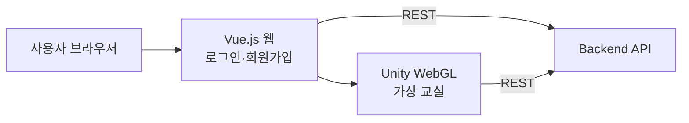

# 🏫 SchoolVerse — 메타버스 교실

**캐릭터로 만나고, 대화하고, 함께 배우는 웹 메타버스 교실**

`SSAFY 5기 2학기 자율 프로젝트` · `2021.10 ~ 2021.11 (6주)` · `5인 팀`

---

## 💡 프로젝트 소개

비대면 수업이 길어지며 학생들은 친구와 어울릴 공간을 잃었습니다.
**SchoolVerse**는 학생이 자신의 캐릭터로 가상 교실을 돌아다니며 친구를 만나 대화하고,
퍼즐 같은 교육용 게임을 함께 즐길 수 있는 **메타버스 교실**입니다.
Unity로 만든 가상 공간을 **WebGL**로 빌드해, 설치 없이 웹 브라우저에서 바로 접속할 수 있도록 만들었습니다.

---

## ✨ 주요 기능

| 기능 | 설명 |
|---|---|
| **회원** | 회원가입(아이디·닉네임 유효성 검사, 중복 확인), 로그인·로그아웃 |
| **가상 교실** | 교실 맵에서 내 캐릭터로 자유롭게 이동 |
| **만남과 대화** | 같은 공간의 친구를 만나 대화 |
| **교육 게임** | 퍼즐형 미니게임을 친구와 함께 플레이 |
| **웹 접속** | Unity WebGL 빌드를 Vue 웹 서비스에 연동해 브라우저에서 바로 실행 |

---

## 🏗 구성

| 폴더 | 내용 |
|---|---|
| `frontend` | Vue.js 웹 (로그인·회원가입, Unity WebGL 연동) |
| `unity` | Unity 프로젝트 패키지 |
| `unity_WebGL` | 웹에 올리는 WebGL 빌드 |
| `backend` | 회원·서비스 API |

---

## 🛠 기술 스택

| 구분 | 기술 |
|---|---|
| **Metaverse** | Unity, C#, Unity WebGL |
| **Frontend** | Vue.js, Bootstrap-Vue, Axios |
| **Collaboration** | GitLab (front·back·develop 브랜치 전략), Jira |

---

## 👤 담당 역할 (장용원)

- Unity 프로젝트 구성: 초기 화면·서비스 설명 화면, 교실 배경과 맵 적용
- 캐릭터 이동·대화·퍼즐 미니게임 등 메타버스 공간 구현 참여
- Vue.js 웹 로그인 페이지 구현
- Unity WebGL 빌드를 웹 서비스에 연동하는 작업 협업

---

## 📝 회고

웹 개발과 전혀 다른 Unity 환경에서, 3D 공간과 화면을 직접 구성하며 새로운 기술을 짧은 기간에 익혀 결과물로 만드는 경험을 했습니다.
특히 Unity 결과물을 WebGL로 빌드해 웹 서비스와 연결하는 과정에서, 서로 다른 기술을 하나의 서비스로 묶을 때 인터페이스를 먼저 맞추는 것이 중요하다는 것을 배웠습니다.
