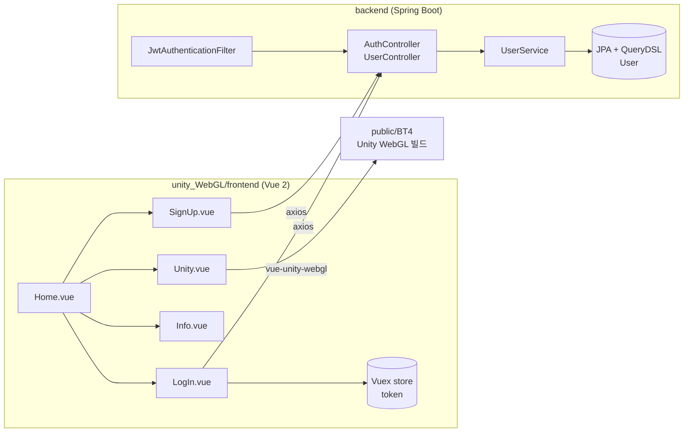
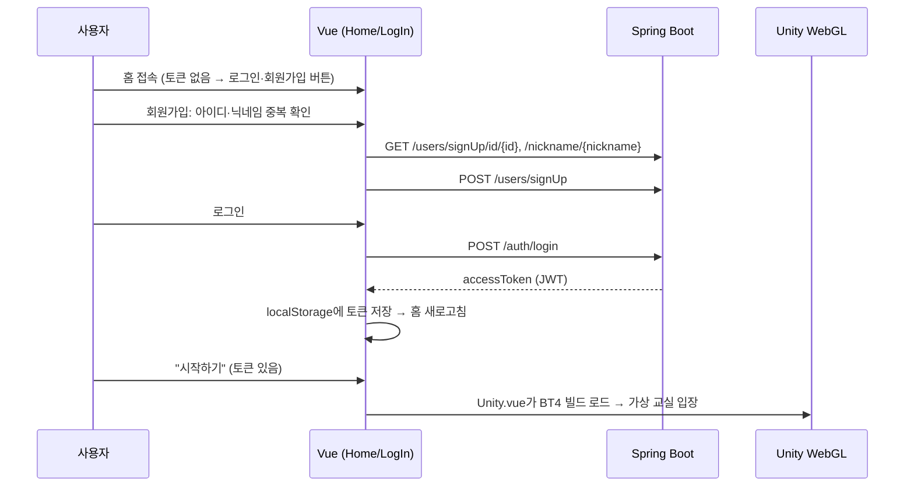

# 📖 SchoolVerse — 코드 가이드

2021년 SSAFY 2학기 자율 프로젝트(5인) **SchoolVerse**의 원본 코드를 다시 읽고 정리한 문서입니다.
폴더별 역할, 로그인부터 메타버스 입장까지의 흐름, 그리고 **지금 다시 본다면 고칠 점**을 적었습니다.

> 담당(장용원): Unity 초기 화면·서비스 설명·교실 배경, Vue 로그인 페이지, Unity 프로젝트 정리

---

## 1. 폴더 구조

| 폴더 | 내용 | 비고 |
|---|---|---|
| `unity_WebGL/frontend` | **실제 서비스 웹** (Vue 2). 홈·로그인·회원가입·소개·Unity 실행 화면 | 최종 결과물 |
| `unity_WebGL/frontend/public/BT4` | Unity가 WebGL로 빌드한 결과(`BT4.json`, `UnityLoader`) | Unity → 웹 연결 지점 |
| `unity` | Unity 프로젝트 패키지(`unityPJT.unitypackage`) | 맵·캐릭터·게임 |
| `backend` | Spring Boot 회원·인증 API (JWT) | SSAFY 기본 템플릿 기반 |
| `frontend/frontend`, `theme_ms`, `frontend/theme` | 초기에 실험한 Vue 화면·테마 | 최종 서비스에는 미사용 |

## 2. 전체 구조



## 3. 화면 흐름



## 4. 주요 코드 설명

### 4-1. Unity를 웹에 띄우는 부분 — `Unity.vue`
```vue
<unity src="./BT4/Build/BT4.json" unityLoader="./BT4/Build/UnityLoader.json" />
```
- Unity에서 WebGL로 빌드한 결과물을 `public/BT4`에 넣고, `vue-unity-webgl` 컴포넌트로 불러옵니다.
- Vue는 로그인·회원가입 같은 웹 화면을 맡고, 실제 3D 공간은 Unity가 그립니다.

### 4-2. 로그인 — `LogIn.vue` + `store/index.js`
- 화면은 아이디·비밀번호를 `userInfo`에 바인딩하고 `this.$store.dispatch('logIn', userInfo)`만 호출합니다.
- Vuex `logIn` 액션이 `POST /auth/login`을 보내고, 성공하면 응답의 `accessToken`을 `localStorage`에 저장한 뒤 홈으로 이동합니다.
- 홈(`Home.vue`)은 `localStorage`의 토큰 유무로 "로그인/회원가입" 또는 "스쿨버스란?/시작하기" 버튼을 보여 줍니다.

### 4-3. 회원가입 — `SignUp.vue`
- 아이디·비밀번호를 정규식으로 즉시 검사하고, 아이디·닉네임은 **중복 확인을 통과해야** 입력창이 잠기고 가입 버튼이 활성화됩니다.
- 모든 조건(비밀번호 일치, 형식, 중복 확인 2개)을 만족할 때만 가입 버튼이 보입니다.

### 4-4. 서비스 소개 — `Info.vue`
- 마우스 휠·터치 이벤트를 직접 받아 섹션 단위로 넘어가는 **풀페이지 스크롤**. 각 섹션 위치(`offsetTop`)를 미리 계산하고 `scrollIntoView`로 이동, 이동 중에는 `inMove`로 중복 입력을 막습니다.
- 교실 이미지(`classroom.png`)를 배경으로 사용했습니다.

### 4-5. 백엔드 — Spring Boot
| API | 설명 |
|---|---|
| `POST /auth/login` | 아이디로 사용자 조회 → `PasswordEncoder.matches`로 비밀번호 확인 → JWT 발급 |
| `POST /users/signUp` | 아이디 중복이 없으면 가입 |
| `GET /users/signUp/id/{id}`, `/nickname/{nickname}` | 중복 확인 |
| `GET /users/me` | 토큰의 사용자 정보 (`JwtAuthenticationFilter`가 인증 처리) |
| `PATCH /users/patch/{id}`, `/patchpw/{id}`, `DELETE /users/delete/{id}` | 토큰의 사용자와 경로의 아이디가 같을 때만 수정·탈퇴 |

- 비밀번호는 `PasswordEncoder`로 암호화해 저장하고, `User.password`에는 `@JsonIgnore`를 붙여 응답에 나가지 않게 했습니다.
- Swagger로 API 문서를 자동 생성합니다.

## 5. 지금 다시 본다면 — 코드 리뷰

### ① 로그인 시 없는 아이디면 서버 에러 (backend)
`AuthController.login`은 `getUserByUserId`가 `null`을 돌려줄 때 그대로 `user.getPassword()`를 호출해 **NullPointerException → 500**이 납니다.
```java
User user = userService.getUserByUserId(userId);
if (user == null || !passwordEncoder.matches(password, user.getPassword())) {
    return ResponseEntity.status(401).body(UserLoginPostRes.of(401, "Invalid ID or Password", null));
}
```
(아이디가 없는지, 비밀번호가 틀렸는지를 구분해서 알려 주지 않는 것도 보안상 좋습니다.)

### ② 상태 코드
중복 아이디·닉네임을 `500`(서버 오류)으로 응답합니다. 서버 문제가 아니라 요청 충돌이므로 `409 Conflict`가 맞습니다. 프론트도 `catch`에서 "이미 존재"로 처리하고 있어, 진짜 서버 오류와 구분이 안 됩니다.

### ③ Vuex 토큰 저장 (`store/index.js`)
```js
state.token = localStorage.setItem("token", value.accessToken); // setItem은 undefined를 반환
```
state에는 항상 `undefined`가 들어가고, 그래서 `router.go()`로 페이지를 새로고침해 `localStorage`를 다시 읽는 방식이 되었습니다.
```js
SET_TOKEN(state, token) {
  state.token = token;
  localStorage.setItem("token", token);
}
// 홈에서는 this.$store.state.token으로 판단 → 새로고침 불필요
```
그 밖에 `getterts` 오타, 로그아웃 시 토큰 삭제 처리, 요청마다 `Authorization` 헤더를 붙이는 axios 인터셉터가 필요합니다.

### ④ 접근 제어
`/unity` 라우트에 가드가 없어, 로그인하지 않아도 주소를 직접 치면 들어갈 수 있습니다. → `router.beforeEach`에서 토큰 확인.

### ⑤ 설정·정리
- `BASE_URL = "http://localhost:8080"`이 코드에 고정 → `.env`(`VUE_APP_API_URL`)로 분리
- 비밀번호 정규식(7~17자)과 안내 문구(8~16자)가 다름
- `Info.vue`에 임시 문구(`~~~`, `Card title`)가 남아 있음
- `System.out.println` 디버그 출력 → 로거(`slf4j`)로 교체
- 사용하지 않는 `frontend/frontend`, `theme_ms` 폴더 정리

## 6. 예상 면접 질문

**Q. Unity와 웹은 어떻게 연결했나요?**
Unity 프로젝트를 WebGL로 빌드하면 브라우저에서 실행되는 파일(로더, 데이터)이 나옵니다. 이것을 Vue 프로젝트의 `public` 폴더에 넣고 `vue-unity-webgl` 컴포넌트로 불러왔습니다. 로그인 같은 웹 기능은 Vue가, 3D 공간은 Unity가 담당하도록 나눠습니다.

**Q. JWT 로그인은 어떻게 동작하나요?**
서버가 아이디·비밀번호를 확인한 뒤 사용자 아이디를 담은 토큰을 서명해서 내려줍니다. 클라이언트는 이 토큰을 저장해 두고 요청 헤더에 붙이고, 서버는 필터에서 서명을 검증해 사용자를 확인합니다. 세션을 서버에 저장하지 않아도 됩니다.

**Q. 토큰을 localStorage에 저장하면 문제는 없나요?**
XSS로 스크립트가 실행되면 토큰을 읽어 갈 수 있습니다. 보안을 높이려면 `HttpOnly` 쿠키에 담거나, 짧은 만료의 access token과 refresh token을 나누는 방식이 좋습니다.

**Q. 다시 만든다면?**
로그인 실패 시 500이 나는 null 처리부터 고치고, 상태 코드를 의미에 맞게(401·409) 정리하겠습니다. 프론트는 Vuex에 토큰을 제대로 저장해 새로고침 없이 화면이 바뀌도록 하고, 라우터 가드로 로그인하지 않은 사용자의 메타버스 입장을 막겠습니다.
